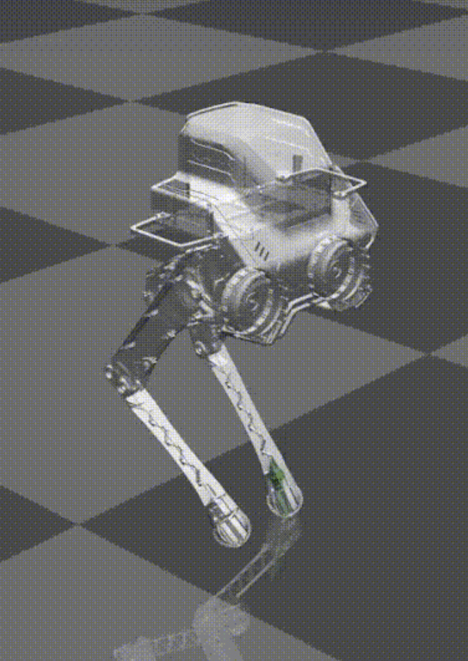
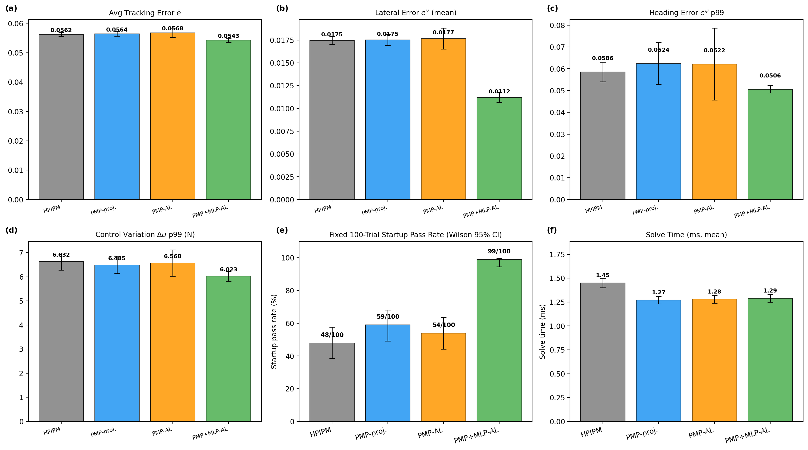

# Learning-Enhanced Pontryagin-Based MPC for Bipedal Robot Locomotion

[](https://doi.org/10.1109/ASCC70886.2026.11701800)


Code for the ASCC 2026 paper *Learning-Enhanced Pontryagin-Based MPC for Bipedal Robot Locomotion*.

The centroidal MPC of a point-foot biped (LimX TRON1, `PF_A` model) is solved with a Pontryagin's Maximum Principle (PMP) optimizer instead of the interior-point QP solver HPIPM. A small MLP predicts the one-step residual of the centroidal dynamics and corrects the MPC prediction model, while the nominal physics model stays in place. All experiments run in MuJoCo.

<p align="center">
  
</p>

## Results



Four controllers on the same walking task, 20 s per trial:

| Controller | What it is |
| --- | --- |
| HPIPM | Original convex MPC with the HPIPM QP solver (upstream baseline) |
| PMP-proj. | PMP solver, friction cone enforced by projection after each solve |
| PMP-AL | PMP solver with an augmented-Lagrangian penalty on the friction constraints, projection kept as a safety step |
| PMP+MLP-AL | PMP-AL plus the residual MLP |

Read from the figure above:

- Tracking error is about the same for HPIPM and both PMP variants (0.0562 / 0.0564 / 0.0568). Adding the MLP lowers it to 0.0543.
- Mean lateral error drops from 0.0175 (HPIPM) to 0.0112 with the MLP, which is the straighter walking reported in the paper.
- Mean solve time is 1.45 ms for HPIPM and 1.27 to 1.29 ms for the PMP variants.
- Panel (e) counts how many of 100 fixed-initialization trials get through startup: 48 (HPIPM), 59, 54, and 99 (PMP+MLP-AL).

The metric panels pool different numbers of runs per controller: 10 (HPIPM), 10 (PMP-proj.), 54 valid runs out of 100 (PMP-AL), and 9 valid runs out of 10 (PMP+MLP-AL). See the header of [`scripts/analysis/analysis_0512_4ctrl.py`](scripts/analysis/analysis_0512_4ctrl.py).

## What is new compared to the upstream code

This repository started from [clearlab-sustech/Bipedal_MPC](https://github.com/clearlab-sustech/Bipedal_MPC) (convex MPC + whole-body control for TRON1 in MuJoCo, ROS 2). The parts added for the paper:

| Component | Files |
| --- | --- |
| PMP optimizer: forward simulation, backward costate recursion, Newton-type control update, augmented-Lagrangian friction penalty with multipliers warm-started across MPC ticks | [`src/motion/generation/src/PMPOptimizer.cc`](src/motion/generation/src/PMPOptimizer.cc), [`PMPOptimizer.h`](src/motion/generation/include/generation/PMPOptimizer.h) |
| PMP wired into the MPC, residual MLP correction (single-step or recursive over the first steps of the horizon), training-data collection, per-trial evaluation logging | [`src/motion/generation/src/ConvexMPC.cc`](src/motion/generation/src/ConvexMPC.cc) |
| MLP inference in C++ (weights loaded from a text file) | [`src/motion/estimation/src/MLPNetwork.cc`](src/motion/estimation/src/MLPNetwork.cc) |
| MLP training with DAgger-style data rounds and noise augmentation | [`scripts/train_mlp_v3.py`](scripts/train_mlp_v3.py) |
| Trained residual model used in the paper (18 inputs, hidden 64 and 32, 12 outputs, ReLU) | [`models/mlp_v1_mse.yaml`](models/mlp_v1_mse.yaml), [`models/mlp_v1_mse.txt`](models/mlp_v1_mse.txt) |
| Evaluation logs and figure scripts | [`eval/`](eval), [`img/`](img), [`scripts/analysis/`](scripts/analysis) |

## Repository layout

```
src/
  assets/            robot models (URDF, MJCF, meshes) and config.yaml
  core/              gait, trajectory and math utilities
  motion/
    generation/      MPC (ConvexMPC) and the PMP optimizer
    estimation/      state estimation (LKF) and the MLP network
    control/         whole-body controller
    gait/            gait schedule
    management/      main node and launch file
  sim/               MuJoCo simulation node
  third_parties/     pinocchio interface, eiquadprog, HPIPM/BLASFEO, MuJoCo binaries
models/              trained residual MLP
scripts/             MLP training, figure and trial scripts
eval/                per-trial CSV logs
img/                 figures
```

## Build

Tested on Ubuntu 22.04 with ROS 2 Humble.

```bash
sudo apt-get install ros-humble-eigenpy ros-humble-pinocchio
git clone https://github.com/Markwcl2004/PMP_based_Bipedal_MPC.git
cd PMP_based_Bipedal_MPC
bash build.sh
source install/setup.bash
```

## Run

Start the simulator and the controller in two terminals, both from the repository root (the MLP weight path in `models/mlp_v1_mse.yaml` is relative to the working directory):

```bash
ros2 launch sim sim_launch.py
```

```bash
ros2 launch management management_launch.py
```

Velocity commands come from a gamepad through the ROS `joy` node, which the management launch file starts. Without a gamepad the command is zero. To hard-code a command, edit `JoyStick::getLinearVelCmd()` and `JoyStick::getYawVelCmd()` in [`src/motion/management/src/JoyStick.cc`](src/motion/management/src/JoyStick.cc).

## Configuration

The controller reads [`src/assets/p1/config.yaml`](src/assets/p1/config.yaml). The keys under `generation` select the variant:

| Key | Meaning |
| --- | --- |
| `use_augmented_lagrangian` | `false` gives PMP-proj., `true` gives PMP-AL |
| `al_rho`, `al_outer_iters`, `al_final_projection_safety` | augmented-Lagrangian settings |
| `use_mlp_residual` | turn the residual MLP on or off |
| `mlp_full_recursive`, `mlp_recursive_steps` | apply the MLP correction only at the first step, or recursively over the first N steps |
| `mlp_config` | path to the MLP yaml (absolute path, set it to your clone) |
| `mlp_residual_clamp` | clamp on the predicted residual |
| `collect_training_data`, `max_training_samples` | log (state, input, next state) samples as CSV for MLP training |

## Training the residual MLP

1. Set `collect_training_data: true` and `use_mlp_residual: false`, then walk the robot. Samples are written as `mlp_training_data_*.csv` to the directory hard-coded in `ConvexMPC.cc` (search for `mlp_training_data_`).
2. Train, for example:
   ```bash
   python3 scripts/train_mlp_v3.py --rounds "round0:<data_dir>/mlp_training_data_*.csv:single-step:1.0" --loss mse --output models/my_mlp.txt
   ```
   The docstring at the top of the script describes the DAgger rounds and the noise-augmentation options.
3. Point `mlp_config` to the generated yaml and set `use_mlp_residual: true`.

## Known limitations

- Simulation only. No hardware experiments.
- The HPIPM baseline in the comparison was run with the upstream repository. In this code base `ConvexMPC` always calls the PMP optimizer.
- Some paths are still hard-coded to the original machine: `mlp_config` in `config.yaml`, the evaluation log and training-data directories in `ConvexMPC.cc`, and the input/output paths in `scripts/analysis/*.py`, which also expect logs from three separate workspaces (HPIPM, PMP only, PMP+MLP). Adjust them before running.

## Citation

```bibtex
@inproceedings{wang2026pmpmpc,
  author    = {Wang, Chunlin and Lin, Zhiyun},
  title     = {Learning-Enhanced Pontryagin-Based {MPC} for Bipedal Robot Locomotion},
  booktitle = {2026 15th Asian Control Conference (ASCC)},
  year      = {2026},
  doi       = {10.1109/ASCC70886.2026.11701800}
}
```

## Acknowledgements

- The simulation, estimation, whole-body control and HPIPM-based convex MPC come from [clearlab-sustech/Bipedal_MPC](https://github.com/clearlab-sustech/Bipedal_MPC).
- The convex MPC formulation follows J. Di Carlo, P. M. Wensing, B. Katz, G. Bledt and S. Kim, "Dynamic Locomotion in the MIT Cheetah 3 Through Convex Model-Predictive Control," IROS 2018.
- Third-party code under `src/third_parties/` (Pinocchio, eiquadprog, HPIPM, BLASFEO, MuJoCo) keeps its own license.

## License

No license is granted for this repository as a whole, because the upstream code it builds on does not carry one. Third-party components keep their own licenses.
